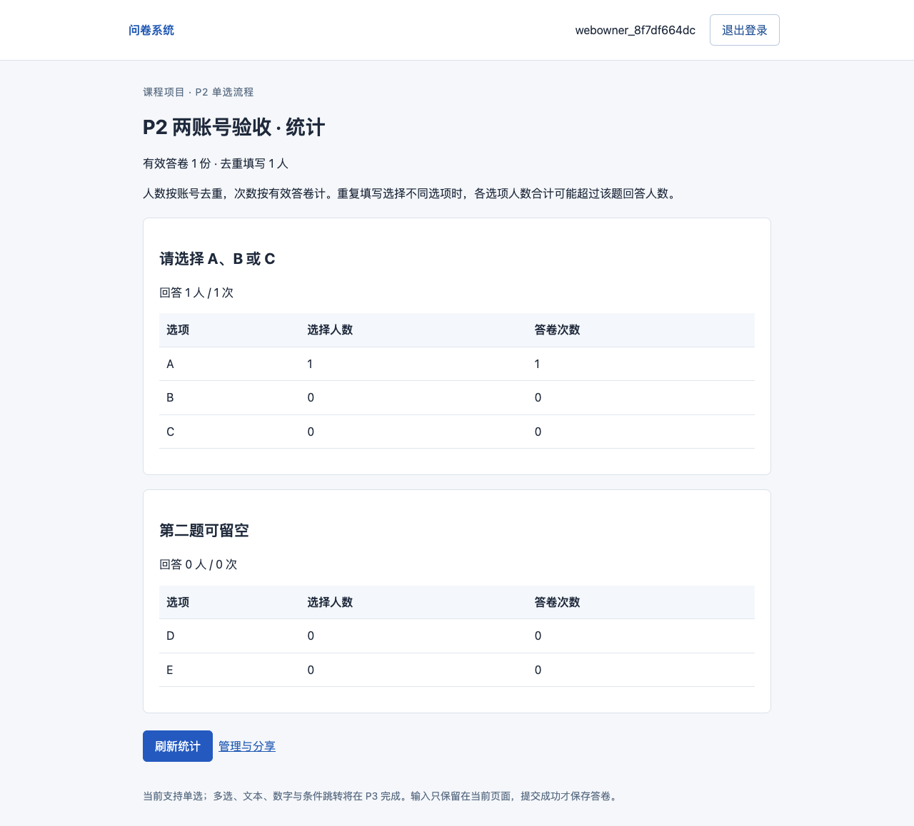
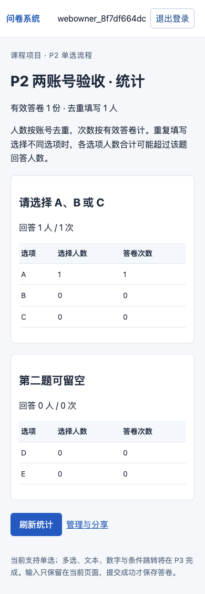
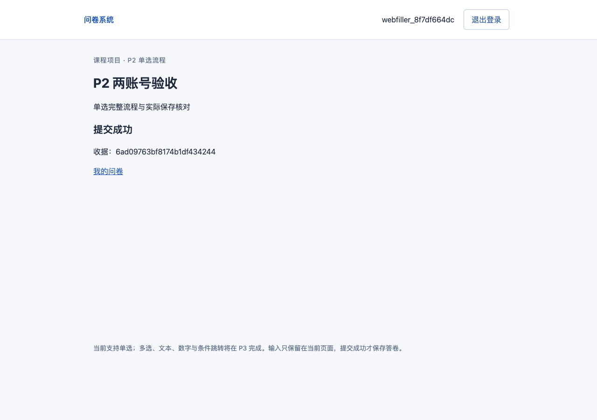

# P2验收记录

日期：2026-10-15（北京时间）。验收对象：`c6e63b67681bdb4000f767a5375fe79af114e5d0`，`main`；正式验收开始时工作区干净。文档基线为`6c5beab`。执行者为Codex；只读子代理参与契约/代码/测试审查，由主代理整合修改。没有用户亲自操作或独立模型验收的记录。

结论：W-005/W-006、P2子集通过；P3—P6未验收。已实现两账号从注册到单选统计的网页链路，配套真实MongoDB测试、应用进程重启、隔离验证入口与运行说明。不能将此结果扩大为第一阶段完整功能通过。

## 环境与命令

复用`contemporary_db`，Python3.11、PyMongo4.18.2；新增FastAPI0.143.1、Uvicorn0.54.0、Jinja2 3.1.6、pwdlib0.3.1及测试依赖，版本锁见根目录requirements.lock.txt。`pip check`实际返回`No broken requirements found.`。未重建环境或升级无关包。

云端只读诊断：课程公网域名本轮能解析，但MongoDB真实ping在10.14秒后返回ServerSelectionTimeoutError；未完成认证，不据此判断密码错误，没有云端业务写入。历史NXDOMAIN没有沿用为当前结论。现有local.mongodb.course未加载且被禁用，首次bootstrap失败；检查disabled状态后启用并加载已有服务，本地ping=1、MongoDB8.0.32。没有新装MongoDB或启动第二实例。

本人业务数据库仅初始化四个survey_集合，未插入测试账号/答卷；原实验users在初始化前后数量均0、内容SHA-256相同。测试专用本地survey_test_<run_id>库，运行后均已清理。业务服务实际在http://127.0.0.1:8000启动，health返回200、ready/P2/schema_version=1。服务即时状态须接手时重查。

正式命令（在项目根执行）：

```bash
/opt/homebrew/Caskroom/miniconda/base/envs/contemporary_db/bin/python scripts/verify.py --stage P2 --node /Users/renbeiming/.cache/codex-runtimes/codex-primary-runtime/dependencies/node/bin/node --playwright-module /Users/renbeiming/.cache/codex-runtimes/codex-primary-runtime/dependencies/node/node_modules/playwright --chromium '/Users/renbeiming/Library/Caches/ms-playwright/chromium-1228/chrome-mac-arm64/Google Chrome for Testing.app/Contents/MacOS/Google Chrome for Testing'
/opt/homebrew/Caskroom/miniconda/base/envs/contemporary_db/bin/python scripts/verify.py --stage P2 --self-test
```

正式P2运行开始于17:05:35，反例检查开始于17:05:52；原始UTC时间、命令、Git版本与文件指纹保留在[自动摘要](P2-自动验收.json)和[反例摘要](P2-验证器反例.json)。Browser插件未列出，采用Playwright1.62.1及本机现有Chromium1228，未下载新浏览器。默认缓存版本与Playwright期待版本不符的首次启动失败已保留在本地artifacts，后续显式指定可用二进制。

## 实际执行与独立预期

[JUnit结果](P2-pytest.xml)记录12项API/真实DB测试全部通过，无失败、无跳过。测试输入与断言在tests/test_p2.py；下面描述本轮检查范围，并非所有T组完整通过。

| 用例/步骤与输入 | 预期与实际核对 | 结果 |
|---|---|---|
| T-01 两账号，U1创建、U2读列表及管理/统计；新应用实例重读 | DB owner=U1，U2列表空、管理/统计404；登录分享配置可读；重启配置相同 | 通过 |
| T-02 保存空题干草稿、旧revision写入、改文案和选项排序后发布 | 不完整可存但不能发布；旧revision409；ID保留；发布后PUT409；P3题型422 | 通过 |
| T-05 必答遗漏/未知选项/未知题/伪造字段/错误版本类型 | 非法提交422、无答卷；evaluate到确认不写库；合法只保存一次完整文档 | 通过 |
| T-05 定点注入真实集合insert异常，再恢复重试；同key改内容、不同key、关闭后原key | 503不假成功，未写入；恢复后201、原key200同收据；冲突409；关闭后成功key仍可恢复 | 通过 |
| T-05 两题顺序：第一必答、第二可空 | 缺第二key不可提交；显式null可提交；path含两题、answers仅一条 | 通过 |
| T-06 F-01的单选投影及r5，含匿名/重复/空答 | 4份3人，Q1=3次2人，A2次2人/B1次1人/C0；r5后5份3人、C1次1人；整卷/单题相同 | 通过 |
| T-07 规范化账号、错密码、短错密码、换令牌、注入到期时钟、退出 | Argon2无明文；通用401；旧令牌撤销；TTL尚未删除也401；退出幂等204 | 通过 |
| T-07 两个线程同时注册同名账号 | 状态201和409、数据库只一名用户 | 通过 |
| T-11 他人写管理接口/读统计，禁止匿名时匿名提交，未登录填卷 | 他人404；非法匿名422且不写库；未登录401；公开配置无内部身份字段 | 通过 |
| T-12 基础同源、未知字段、JSON格式、过大请求与错误脱敏 | 缺Origin/写头或外站403；非法JSON400；未知字段422；过大413；不回显密码/输入值 | 通过 |
| T-13 实际索引及validator；直插缺repeat_allowed/错误类型/版本2；删除TTL索引后health | 四集合规格一致；无效文档Mongo错误121；缺索引health503，不假就绪 | 通过 |
| T-13 清理保护：业务库、远端、错误run_id、带DB的测试URI | 全部ValueError，合法本地本轮库才允许；未对业务库执行drop | 通过 |

密码/URI错误内容不写入证据。PyMongo索引、validator与聚合使用真实MongoDB；数据库故障只定点注入，不以模拟库替代持久化。pytest保留一条Starlette TestClient旧httpx适配器弃用警告，不影响断言；不是应用报错，后续维护时可处理。

## 网页、重启与视觉检查

实际网页流程：账号甲注册登录→创建草稿→添加两道单选（第一必答、第二可空）→保存→发布→分享链接；账号乙从链接被引导登录、注册登录返回链接→必答空值提示→选B→第二题显式留空→确认→回退修改为A→匿名确认提交；甲查看整卷统计。确认时答卷数为0，提交后为1份/1人；第二题0人0次，D/E零项显示。非创建者统计404。

另在浏览器截断已经成功写入的响应JSON：页面出现“重试原提交”，修改按钮禁用；原请求体与重试请求体逐项相同，原收据恢复，答卷仍为1份。服务端落库实查：2账号、1问卷、1答卷，path长度2、非空answers长度1、anonymous=true、repeat_allowed=false。

验证器真正停止Uvicorn进程后重新启动，health就绪后核对答卷全字段摘要相同，统计仍1份。此为应用重启持久化，不宣称已测试MongoDB重启或机器重启。

| 网页检查 | 结果 |
|---|---|
| URL/标题、非空、无错误覆盖层 | 通过 |
| 按钮操作后状态与数据库实际变化 | 通过 |
| JavaScript运行错误 | 无 |
| 控制台网络错误 | 仅分享链接未登录时auth/me的预期401，无其他错误/警告 |
| 1280×900和390×844 | 已截图并目视检查中文、表格、换行及按钮，无横向溢出或遮挡 |
| 截图证据 | 下列三张；合成测试账号，不含真实答卷 |





## 验证器反例与真实修复

三种刻意反例分别执行子进程，缺R-001映射、故意assert False测试、无效业务库名均返回1；失败测试确实运行后以API tests failed拒绝。它们是验证器自测，不是业务缺陷。P3/P4/P6和changed尚未启用，入口明确拒绝，不返回虚假的通过。

真实首轮pytest为9通过2失败：T12测试辅助客户端重入同一应用lifespan，关闭了共享Mongo连接，改成共享已有lifespan的HTTP客户端；T13删除索引后health抛RuntimeError，改为503契约未就绪。未删除断言或降低预期。

代码审查另发现：登录复用注册长度约束导致短错密码422；非法JSON错误码不符；截断响应解析异常未标结果未知；Literal[1]实际接受bool/float；这些已修复并加检查。验证工具修复包括避免私钥标记扫描匹配自身、识别预期auth/me 401、补T12映射、扩展审查指纹、补配置示例扫描和保证清理失败仍落盘。没有伪造修改前未运行过的业务失败案例。

## 原题保护与范围

两份原材料SHA-256与tests/original-materials.json及P1记录相同；未改原题或教材。11—14仅追加P2实施范围说明，稳定ID、schema_version=1、content_version=1与冻结内容策略保持。AI日志与R映射同步04/06。

未执行：其他题型、F-01全题型/F-02、三类跳转、完整时间边界/并发重复/关闭竞争、全安全/资源用例、P4独立验收、P5报告与P6封存。用户尚未亲自演示或终审文字；不影响本轮P2自动验收结论。下一项W-007见agent-handoff。
