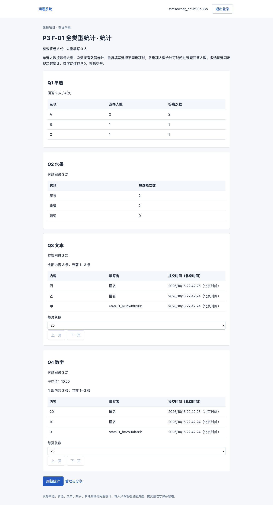
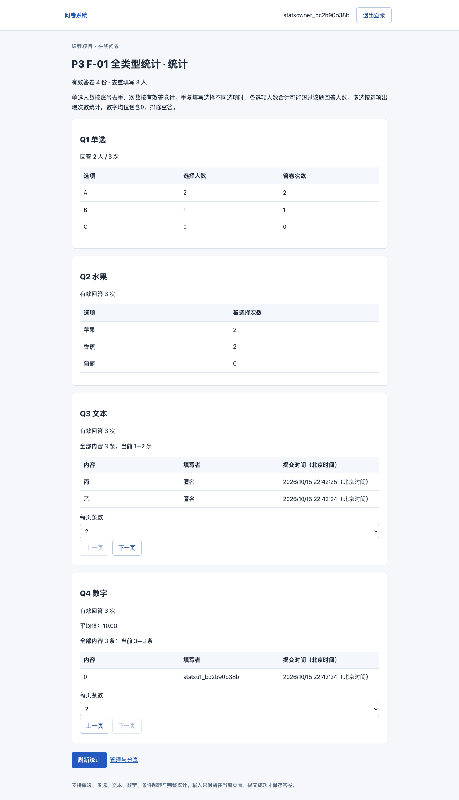
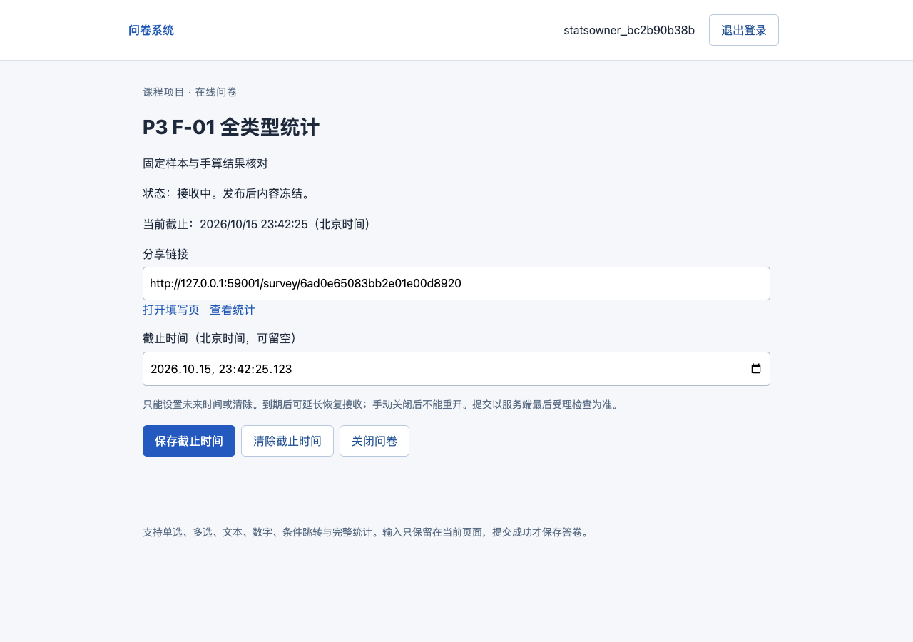

# P3 / W-008验收记录

2026-10-15。结论：P3全部第一阶段业务验收通过，W-008完成。P4独立验收及P5/P6最终文档、独立安装复现和封存未执行。主代理实现与验证，同模型子代理只读辅助审查；不冒充用户终审或独立模型验收。

正式代码版本`d6a206279a4339009f4195b91b64829407677bd1`，main，运行开始dirty=false。后续仅保存日志/要求证据/交接，不改变已验收代码。接手620d266干净，先实际执行W007完整回归通过。

## 实际执行与证据

```bash
PYTEST_ADDOPTS='-k deliberately_select_no_cases' /opt/homebrew/Caskroom/miniconda/base/envs/contemporary_db/bin/python scripts/verify.py --stage P3 --node /Users/renbeiming/.cache/codex-runtimes/codex-primary-runtime/dependencies/node/bin/node --playwright-module /Users/renbeiming/.cache/codex-runtimes/codex-primary-runtime/dependencies/node/node_modules/playwright --chromium '/Users/renbeiming/Library/Caches/ms-playwright/chromium-1228/chrome-mac-arm64/Google Chrome for Testing.app/Contents/MacOS/Google Chrome for Testing'
```

故意设置会筛掉所有测试的继承环境，入口清除PYTEST_ADDOPTS并覆盖addopts，仍实际执行全部参数案例。先收集再核对JUnit完整多重集合，收集不算通过。[自动报告](P3-自动验收.json)、[JUnit](P3-pytest.xml)、[收集清单](P3-测试收集.log)：81案例，P2回归12、W007回归43、W008新增26，失败0/跳过0。包含真实MongoDB，不是模拟聚合/写入。完整开始UTC时间及命令/代码SHA见自动报告，run bc2b90b38b0946d1ab910704e16fd921。

[原P2网页](P3-browser.json)、[W007网页](P3-browser-w007.json)、[W008网页](P3-browser-w008.json)三套均通过，包含配置/三类跳转/F02回退、失联原内容重试、实际四题型填写、F01全部统计/分页/匿名、异地时区截止、HTML不执行及外站回跳。全部9份答卷实查后应用进程重启，摘要相同；测试专库安全清理成功。不宣称机器或MongoDB服务重启。

## F-01固定预期与实际

| 对象 | r1—r4预期及实查 | 加r5后预期及实查 |
|---|---|---|
| 整卷 | 4份/3人（含1份全空） | 5份/3人 |
| Q1单选 | 非空3次/2人；A次数2/人数2，B1/1，C0/0 | 非空4次/2人；A2/2，B1/1，C1/1 |
| Q2多选 | 非空3次；苹果2、香蕉2、葡萄0 | 不变 |
| Q3文本 | 非空3次；丙、乙、甲，2条/页完整翻页 | 不变 |
| Q4数字 | Decimal128(20)、10、0；非空3次，均值10.00 | 不变 |
| 匿名 | 丙/乙只含value、created_at、anonymous；甲实名含username | 统计不泄漏账号ID、键或摘要 |

每题整卷/单题摘要相同，r5刷新自动来自数据库。optional全空只计整卷，不增加题目分母。同created_at另有真实DB案例检查_id倒序分页，不漏不重。数字另测±1.005→±1.01、34位精度、1E-6176、最大有限值两次及正负取消；没有二进制浮点。

## T-08—T-13与回归

| 检查 | 实际结果 |
|---|---|
| T08截止 | 截止前1ms接收；相等/后1ms拒绝。无时区、过去/同毫秒及UTC越界422；旧revision409。仅截止/更新时刻/revision改变，过期延长/清除可恢复，closed不可重开 |
| T09并发与防重 | 十账号独立会话在真实insert屏障重叠，保存10份/10人及各自完整内容；repeat开/关×不同键/同键/改内容六种竞争数量准确。实际写成功后人为丢失确认503，关闭后原键200且仅1份 |
| T10关闭竞争 | 暂停最后受理检查后的真实insert，关闭或推进到截止；新提交409，已受理原请求释放后201；原键重试200、改内容409 |
| T11权限与匿名 | 创建者可读统计/内容/改截止；其他账号404，未登录401；分页范围422、未知题404，匿名JSON直接白名单 |
| T12页面与来源 | 跨站Origin/缺写头拒绝；题干/文本HTML作为字面值，无img/script或执行；四类外站next回到站内。旧成功及故意延迟422均不能覆盖新END确认 |
| T13工程契约 | 大请求413、超限/错误decimal422；真实TTL规格漂移、validator漂移、未知schema导致不就绪/启动失败；隔离库恢复后继续。旧P2/W007必填/错误BSON/上限反例完整执行 |

P2响应截断与旧单选JSON继续通过。W007原待统计断言因功能完成改为18.00及无pending；全部其他业务断言保持。标题/题干/选项表情及6000表情文本通过，不按UTF16截断。

## 实际问题与修复

[真实失败及修复摘要](P3-修复记录.json)保留：首轮API78通过/1并发测试失败（复用登录撤销旧会话）；真实Mongo `$avg`中间和溢出；极端时区转UTC OverflowError；首轮阶段API80通过但Playwright日期.000输入格式失败。每项修改和后续真实执行在04记录。故意索引/validator漂移、失联和旧422是验收注入，不冒充生产故障。

常规平均值仍Mongo Decimal128聚合，只有非有限结果才精确流式重算；额外查询不承诺并发快照。最后受理检查后允许在途完成，不承诺跨集合事务。匿名内部仍关联账号用于人数/防重，创建者看不到匿名身份。

## 网页视觉检查

桌面1280×900、手机390×844截图已实际打开检查：中文/数据可读、分页按钮可操作、无裁切遮挡或横向溢出。北京时间管理在浏览器America/Los_Angeles时区下仍保存正确UTC毫秒。控制台仅保留P2预期未登录401及W007刻意延迟的准确一条422（type/全文/URL精确匹配）；其他警告、错误与pageerror为空。





移动长页另见[移动截图](P3-统计移动.png)。截图不代替API及真实数据库断言。

## 验证器反例与运行服务

`python scripts/verify.py --stage P3 --self-test`实际执行缺映射、故意assert False测试、无效业务库名三种反例，均退出1；[自测摘要](P3-验证器反例.json)只标passed_counterexamples_only，不替代正常阶段验收。

原题Word/需求Markdown指纹保持。复用contemporary_db、原依赖锁与本地Mongo8.0.32；云端沿用同日W005只读诊断失败结果，本轮无云写入。核对原PID88214命令/cwd/端口后正常停止，已用当前代码启动PID1575/终端session19080；[本机系统](http://127.0.0.1:8000) health200/ready、stage=P3/work_package=W-008。

[业务数据保护](P3-业务数据保护.json)更新前后实验users及survey_四集合数量与完整文档摘要相同，当前均空；没有把测试账号留入业务库。测试仅操作本地survey_test_<run_id>，正式验收库已清理。不存在数据迁移、原文修改或Git推送。下一项W009/P4，见交接。

收尾静态复核实际通过：24项要求/38个测试函数映射、文档链接、凭据模式、原题指纹、当前文件与正式报告全部源码SHA一致，审查指纹有效；仅状态/证据文档新增，git diff --check通过。
