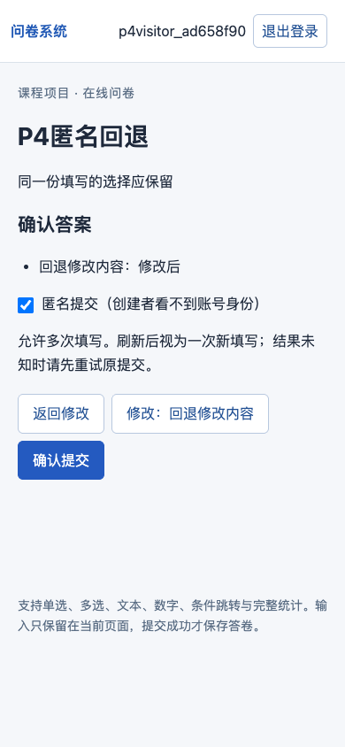
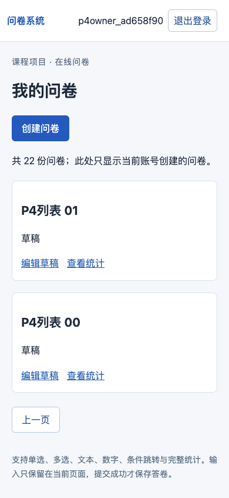

# W-009 / P4独立验收

2026-10-16，结论：**P4已验收**。正式运行`ad658f9034504c0394278afd92be93b6`，代码`0ce7bc1`（完整SHA见JSON），main，开始dirty=false；101项API/真实Mongo参数案例、四套网页、全部10份网页答卷的独立BSON核算、四集合应用进程重启及五个验收器反例全部通过。0失败、0跳过；测试库已清理。收尾后仅追加证据/日志/状态及两处文字归属修正，不改变已验收业务源码或测试断言。

独立指从原文重新核对预期、测试、代码与实际数据的检查步骤；主代理执行并修复，同模型子代理只读辅助，**不是独立模型审查或用户终审**。不是将旧P3报告更名：正式报告包含独立P4运行号、固定P4集合、新探针、raw_database_oracle、逐R源码SHA与实际nodeid。

## 对象与入口

- 先读课程/项目AGENTS、交接、06/08/11—14；逐段读取原Word XML及需求Markdown，回查教材3.1/3.2。原题SHA未变。
- 接手main/d27c065干净，P3源码d6a2062。先实际[P3回归](P4-接手P3回归.json)：81案例、三网页及重启通过，run `5a62ec55dff244a09caab3c2635969c6`。
- [固定P4映射](../../tests/requirements-map-p4.json)、[独立步骤与预期](../W-009-独立检查.md)、[正式报告](P4-自动验收.json)、[JUnit](P4-pytest.xml)、[完整收集](P4-测试收集.log)。报告的requirements逐R绑定源码指纹、实际完整用例身份、网页和语义审查；groups逐T关联步骤/输入/预期及实跑案例。
- 命令为`python scripts/verify.py --stage P4`，指定当前既有Node/Playwright/Chromium路径；完整命令、测试指纹和时间在报告。Python使用contemporary_db，Mongo8.0.32，仅本地本轮survey_test_ID。未重新测试云端，沿用W005真实失败后的本地配置。

## 必须集合与结果

| 检查 | 实际结果 |
|---|---|
| 24项业务R集合 | R001—003/005—024/027全部有对应源码/运行或实际语义审查；R002依赖源码、R027本轮日志专门对应 |
| T01—T13 | 全部执行：旧81案例与新增20案例，共101，0失败/0跳过 |
| F01 | r1—4为4份/3人；r5后5份/3人；Q1 A2次/2人、B1/1、C1/1，题目4次/2人；Q2[2,2,0]；文本丙乙甲，数字20/10/0，均值10.00 |
| F02 | 原固定路径、首条命中、回退pending复用、END清空与不复活；更换全部ID和文字仍符合相同语义 |
| 新边界 | 真实同revision两线程一200一409且整份内容为胜者；23份API分页及22份网页分页无漏重/越权；六种消去排列及四种双舍入边界正确；七类超大整数422 |
| 原始数据独立核算 | p4_audit不导入app路径或统计函数，逐字段检查F01五答卷、F02两答卷、匿名回退答卷；全部10份答卷的引用、path、非空答案与v1版本正确 |
| 四集合重启 | users/surveys/responses/sessions数量与完整文档摘要相等；仅应用进程重启，不声称重启Mongo或机器 |
| 五失败反例 | 缺映射、真正失败测试、非本轮测试库、缩减映射、缺独立检查均退出1；不是把这些预期失败当业务失败 |
| 原题与旧断言 | Word/Markdown、旧三套API/网页和F01/F02与d6a2062无diff；无依赖升级/schema迁移 |

## 真实缺陷与修复

[修复记录](P4-修复记录.json)保留首轮11个API失败、另4个双舍入失败、两项网页失败和首轮验收器元数据噪音失败，未将它们改成通过。

- 数值：`1E34、1、-1E34`的有限均值可能错误显示0.00；改为从实际Mongo数值流式精确累加，显示0.33且六种顺序一致。随后验证±1.004999…9995的双重舍入，显示直接按精确总和/计数一次HALF_UP得到±1.00，API average继续Decimal128精度。代价是每数字题一次额外查询，不声称并发快照或性能提升。
- 资源边界：超大revision/offset不再触发500；按既有BSON int32/int64限制输入，版本达到int32上界后409防加1破坏schema。
- 网页：合法70码点表情密码能完整注册并登录；同一次填写返回修改后保留匿名勾选，成功后再填一份才默认实名，实际保存和匿名内容JSON均核对。
- 验收器：固定canonical映射、四基线测试文件、完整nodeid；额外文件仅追加。全量对象指纹在开始/结束一致，排除已忽略的`.DS_Store`，未放宽源码或文档检查。

## 网页QA

使用frontend-testing-debugging的Playwright分支；本次Browser插件未提供。环境为本地动态端口（见各网页JSON），桌面1280×900、手机390×844；P3截止流程还以America/Los_Angeles浏览器时区核对北京时间转换。当前业务服务在[本机系统](http://127.0.0.1:8000)，health为P4/W-009。

| 检查 | 结果与证据 |
|---|---|
| 页面身份/非空 | URL、标题和有意义控件符合流程，非空白页 |
| 框架错误层 | 未出现错误覆盖层 |
| 控制台 | 无未解释错误；旧P2未登录401和W007刻意晚到422按精确URL/类型单独验证，其他错误仍失败 |
| 实际交互 | 两账号创建发布→登录填写→确认→提交→统计；F02回退/END；F01匿名分页/刷新/截止；P4密码/列表/匿名往返 |
| 视觉 | 查看运行截图，中文/表格/按钮可读；桌面及手机无横向溢出，确认页匿名选择可见 |
| JSON/DB一致性 | 四套网页输出后另读真实BSON，检查10份完整答卷及匿名白名单 |

网页记录：[P2回归](P4-browser-p2.json)、[W007回归](P4-browser-w007.json)、[W008回归](P4-browser-w008.json)、[P4独立流程](P4-browser-independent.json)。截图为本次P4新执行生成，旧脚本页面中的P2/P3字样仅为回归样本标题。

## 数据保护与剩余范围

[业务数据保护](P4-业务数据保护.json)：旧服务PID1575命令/cwd核实后停止，当前PID80762/终端session23466。本人业务survey_四集合及实验users在整轮/服务更新前后数量与完整摘要相同，无测试账号植入业务库。测试库均清理，云端无写入、无重装Mongo。

P4通过仅覆盖本轮业务与独立验收；P5/P6、T14/T15、R004/025/026/028—030最终提交文档、用户文字与贡献终审、干净安装复现、v1封存均未执行，留W-010。当前统计跨查询不承诺快照，同页之外的答题草稿恢复仍不保证，均为既定范围。未测试其他浏览器引擎或公网部署。

[收尾静态核对](P4-收尾静态核对.json)检查原题、旧断言、正式报告逐字节一致、当前源码、审查指纹与提示词；不将文档收尾当作新业务运行。

下一轮说明与可复制提示词见[当前交接](../agent-handoff.md)和[14](../14-正式开发交接与工作包.md)，本轮不创建新对话、不推送或开展W-010。

