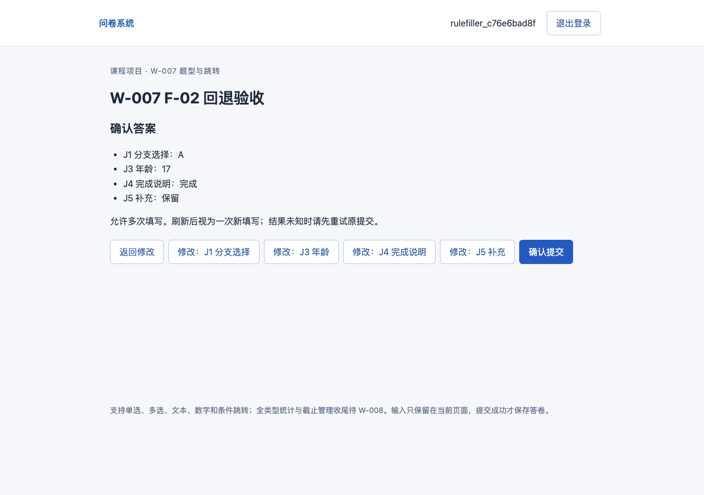
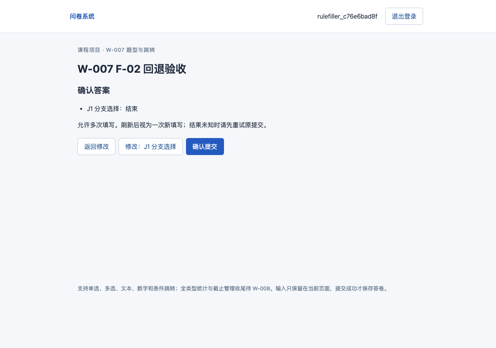
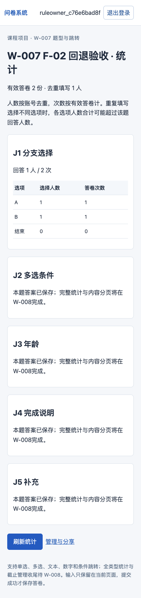

# W-007验收记录

日期：2026-10-15（北京时间）。最终验收代码：`eee15378ce4681e39472a864f19d9c08ea140841`，main。最终增强回归开始时dirty=true，仅状态/证据文档待提交；应用、测试与审查记录均已提交，完整文件指纹保存在自动摘要。此前实现提交864b1b6也在干净工作区通过全量验收。接手版本`11038a4`无未提交修改，P2统一入口重新实际通过。主代理实现并整合修复，子代理仅只读审查契约/代码/测试；不称独立模型或用户人工验收。

结论：W-007通过，P3进行中。完成全部题型、约束、三类配置跳转、回退重算与答案清理；T-03/T-04、固定F-02及网页回退已实际执行。W-008完整统计、内容分页、截止修改和时间/并发收尾仍未完成，不把本次结果写成完整P3通过。

## 环境、命令与证据

复用contemporary_db与锁文件，Python3.11/PyMongo4.18.2/MongoDB8.0.32，未升级依赖、重建环境或改数据库validator/索引。沿用同日W-005只读云诊断失败后已启用的本地服务，本轮没有重新声称云端诊断或云端业务写入。Node/Playwright1.62.1与现有Chromium1228按load_workspace_dependencies和实际缓存核对；Browser插件未列出，继续使用Playwright。

```bash
/opt/homebrew/Caskroom/miniconda/base/envs/contemporary_db/bin/python scripts/verify.py --stage W007 --node /Users/renbeiming/.cache/codex-runtimes/codex-primary-runtime/dependencies/node/bin/node --playwright-module /Users/renbeiming/.cache/codex-runtimes/codex-primary-runtime/dependencies/node/node_modules/playwright --chromium '/Users/renbeiming/Library/Caches/ms-playwright/chromium-1228/chrome-mac-arm64/Google Chrome for Testing.app/Contents/MacOS/Google Chrome for Testing'
/opt/homebrew/Caskroom/miniconda/base/envs/contemporary_db/bin/python scripts/verify.py --stage W007 --self-test
```

最终增强回归开始19:20:59，自测开始19:21:52；完整UTC时间、命令、版本、dirty与文件指纹见[自动摘要](W007-自动验收.json)、[三反例](W007-验证器反例.json)。[JUnit](W007-pytest.xml)共55案例：P2回归12、W007参数化43，失败0、跳过0。参数名全部保留；需求映射以裸函数名关联，同时逐案例拒绝失败/跳过。

## T-03 / F-02独立预期与实际

固定UUID与配置见tests/fixtures_f02.py，预期源于13，未调用实现函数生成预期。所有API提交与BSON核对使用真实MongoDB隔离库。

| 步骤/输入 | 固定预期与实际断言 | 结果 |
|---|---|---|
| A、18、J5=null | path[J1,J3,J5]；跳过必答J4；实际存2个非空答案，数字为Decimal128(18) | 通过 |
| B、[x,y]、完成、J5=null | any[x]首条先于all[x,y]，path[J1,J2,J4,J5]，实际存3个非空答案 | 通过 |
| B、[y]、18、保留，回改A | 删除J2，保留J3和J5，path[J1,J3,J5] | 通过 |
| 接上例J3=17 | path[J1,J3,J4]等待J4，J5只在pending，不可提交 | 通过 |
| J4=完成 | 复用仍可达J5，path[J1,J3,J4,J5]进入确认 | 通过 |
| J1=结束，再改A | END时path仅J1、其他缓存清空且不自动保存；改回A停J3，J3/J5旧值不复活 | 通过 |
| 数字六操作符相对18的17/18/19，及null | eq FTF、ne TFT、gt FFT、gte FTT、lt TFF、lte TTF；null一律默认下一题 | 通过 |
| 多选any/all/exact，exact逆序集合 | 按集合语义匹配，重复选项422，空答不匹配；规则按保存顺序首条命中 | 通过 |
| 另一个草稿修改A目标并发布 | 同答案分别到J3/J4；相交规则重排后从J4改到J5，证明行为来自配置与规则顺序而非问卷常量 | 通过 |
| 混入旧分支、缺当前题key、未知题、伪造字段 | 422且数据库无新增；旧分支为STALE_BRANCH_ANSWERS；非法旧业务范围可由evaluate清除但不悄悄提交 | 通过 |

回退在errors时也应用确定清理，当前原始输入保留；全局先检查结构/ID/类型/选项，业务范围只校验当前路径。待确定的后续候选仅页面内存，没有服务器答题草稿。最终保存path含显式空答，answers仅路径上的非空项。

## T-04配置与答案约束

| 输入/边界 | 预期与实查 | 结果 |
|---|---|---|
| 四类必答/可空/缺key | 必答空值422；非必答显式null或空表示合法，缺key不能自动跳过 | 通过 |
| 多选min=max=2，输入1/2/3项；重复/未知选项 | 仅2项合法；optional留空合法；逆序[B,A]存[A,B]，同key同语义只1份 | 通过 |
| 文本“  中文 A  ”与𠮷/👩‍💻 | trim后“中文 A”长度4；补充平面字符1码点；组合表情3码点，不按字形 | 通过 |
| 整数18.0/18.5，范围0/120/-1/121 | 18.0、0、120合法；18.5/-1/121拒绝；可填写负值取决于范围 | 通过 |
| 34位系数、1E-6176、1.005、35位不精确、溢出/NaN/Infinity | 前者无损Decimal128，后者422；API数字配置字符串；18/18.0与-0/0同key同摘要 | 通过 |
| 数字范围17.5—18.5整数与0.1—0.9整数 | 前者发布可答18，后者可存草稿但发布422，无可行整数 | 通过 |
| 下限大于上限、max=0、计数超选项数、重复文本、前跳/悬空/错op/错条件集合 | 类型合法草稿保存并给publish_issues，发布422 | 通过 |
| 错误API类型、非法UUID、负数/小数/字符串数量、工程上限/50条规则、无损精度失败 | 结构/资源问题草稿即422；不等同业务不完整草稿 | 通过 |

1.005本轮只验证原值无损保存，未执行平均值1.01测试；均值及F-01全题型属于W-008。所有新增题型的统计目前明确pending_W008，不返回伪造的统计值。

## 真实网页与重启

编辑网页创建F-02的全部题型、必答/范围/字数和三类规则；保存后直接核对kind/required/validation/rules独立预期，刷新再核对ID及配置一致，发布分享。填写账号按B→y→18→保留，再回A、回17、补J4，验证J5候选复用；J4超长输入错误提示后保留原输入；END只显示J1且答卷数仍0，改回A不复活旧值。

页面延迟一个旧evaluate请求：在途字段禁止编辑，允许返回前题改END，新路径先确认后才释放旧请求，界面仍只有J1，旧成功响应不能覆盖新状态；旧错误结果的丢弃由代码审查核对，本轮没有单独注入旧错误响应。随后明确提交A路径和B/[x,y]路径两份，数据库按时间查到[J1,J3,J5]、[J1,J2,J4,J5]，非空答案2/3条，数字Decimal128(18)、多选[x,y]顺序正确。该问卷2份/1人，另有P2回归1份，合计3份；辅助Unicode问卷只确认未提交。

辅助文字题实际输入6000个😀（12000 UTF16单元、6000码点）完整保留且可进入确认，验证没有浏览器maxlength截断。P2响应截断恢复及权限、零选项统计完整回归通过。验证器停止并重新启动应用进程，全部3份答卷摘要不变；不宣称机器/MongoDB重启通过。

| 网页检查 | 实际结果 |
|---|---|
| 编辑/填写/确认页面身份与内容 | 正确，GUI配置读回精确匹配F-02 |
| W007控制台和JS错误 | 均无；P2分享入口保留预期未登录401检查 |
| 桌面1280×900、移动390×844 | 确认页/END/移动截图检查无裁切或遮挡，移动无横向溢出；编辑完整布局及字段DOM已核对 |
| 规则/选项编辑 | 网页实际执行选项/规则排序、规则删除、临时题型切换及删除，恢复后所有配置/ID与前值一致；API发布检查重排后的前跳 |





编辑长页证据另见[编辑配置截图](W007-编辑配置.png)，不以截图代替接口/数据库核对。

## 审查、修复与原文保护

初次P2回归12通过；首轮W007+P2参数化54案例全部通过，补规范化回归后正式55通过。本轮没有业务pytest失败，不编造修改前未运行的失败案例。只读审查实际发现并修复：文本maxlength按UTF16少收合法字符、单选空白未规范为空、慢评估仍可编辑/旧错误可能干扰、参数化JUnit与裸函数映射不一致。浏览器配置读回由“前后相同”补为对具体契约的断言，多选逆序/-0/空白数字增加回归。P2旧“多选不支持”反例更新为未知kind反例，按钮禁用断言更新为已启用，均因明确功能扩展，未删除失败断言或改需求。

W007验证器三种刻意反例（缺映射、真正运行assert False测试、无效业务库名）均退出1；自测结果只称counterexamples，不作为W007业务通过。正式验收已单独通过。

原Word/需求Markdown SHA-256与P1/P2保护清单一致。业务/实验集合在应用更新前后数量及文档摘要相同（当前均空），测试在独立survey_test_<run_id>并清理；没有改本人已有记录或触碰其他数据库。保留四集合/索引、schema_version/content_version、旧单选代码与固定样本。真实AI过程与R映射同步04/06，下一项W-008见agent-handoff。

中断恢复补记：用户要求“继续中断的任务”后，核对Git只剩收尾文档、最终报告/JUnit与代码指纹及运行服务；补齐当前交接并提交。未重做已通过且源码未变化的业务测试，也未进入W-008。
