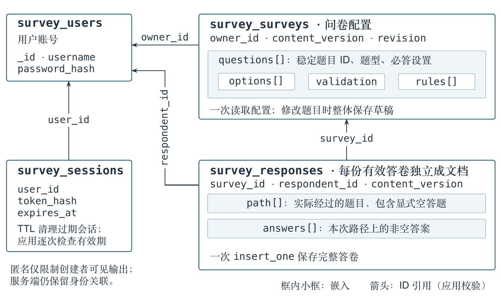
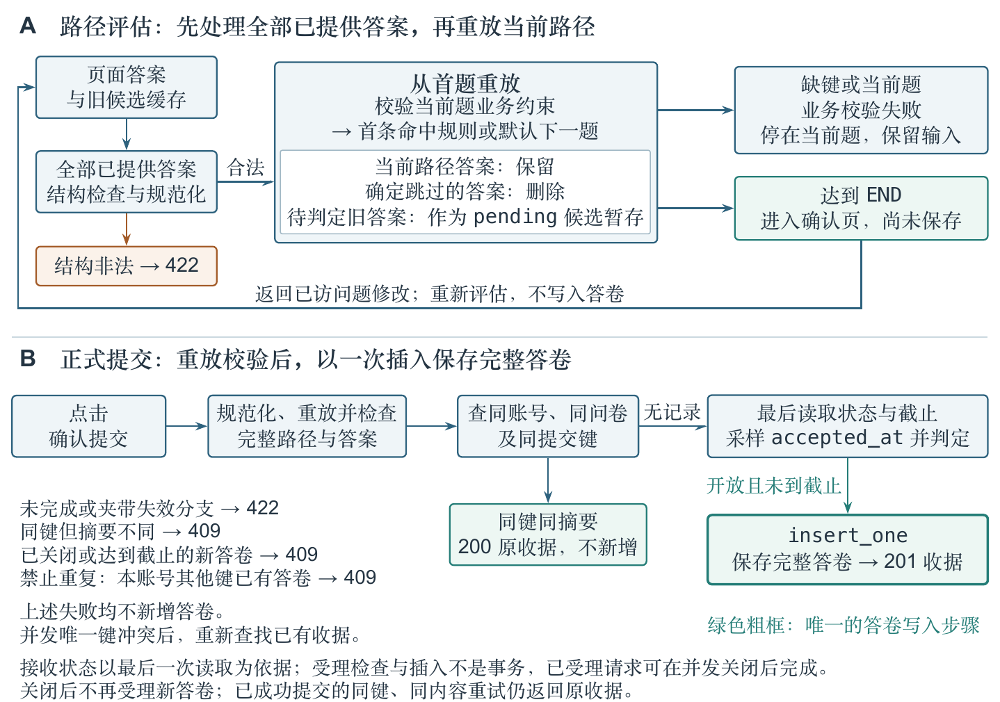
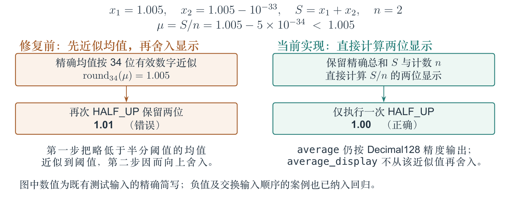

GitHub 仓库链接：[https://github.com/Rbmmmm/ecnu-dbms-2026-pj1](https://github.com/Rbmmmm/ecnu-dbms-2026-pj1)。

# 基于 MongoDB 的问卷系统设计与验证

第一阶段课程项目报告\
作者：任北鸣\
日期：2026 年 10 月 22 日

**摘要**　可配置问卷的实现需要同时处理题目结构、动态填写路径和统计含义。重复填写、返回修改与有限数值精度使这些问题相互关联：答案必须对应原有题意，失效分支不能进入答卷，人数与填写次数也不能混用。本项目依据课程要求实现四题型在线问卷系统，按整体读写边界组织 MongoDB 文档，将配置嵌入问卷、将每次提交保存为独立答卷，并结合发布冻结、稳定标识、服务端路径重放和唯一索引约束写入。数字统计使用精确累加与一次显示舍入，修复实际发现的消去和双重舍入问题。2026 年 10 月 22 日，首发代码版本的 101 项 API 与真实数据库案例全部通过，四套网页流程、独立 BSON 核算、应用重启与样本恢复符合预期；全新 Python 环境安装后，同一批案例再次通过。结果支持系统在既定规则、测试输入及本机环境下的功能正确性；项目未进行性能基准比较，跨查询统计不保证同一快照，已受理请求可在关闭后完成。

**关键词**　MongoDB；文档建模；可配置问卷；路径重放；数值精度；系统验证

## 1. 引言

课程要求实现一个支持创建、发布、填写和统计的在线问卷系统，使用 MongoDB 保存数据，并在第二阶段继承第一阶段的代码与旧数据。这一任务的设计重点不止是保存题目和答案，题目可以配置条件跳转，填写者可以返回修改，问卷还允许匿名和重复填写；这些行为会改变实际路径、有效答案集合和统计单位。若只按页面当前显示的内容保存，旧分支答案可能被带入提交；若只统计答卷数量，又无法表达去重填写人数。

本报告会依据已经完成的实现与验证记录，将设计讨论组织为三个问题。第一，如何划分文档边界，使配置读取、完整提交和历史题意解释相互兼容？第二，如何在返回修改时清理失效答案，同时保留尚可能有效的回答，并明确确认、受理与持久化的界限？第三，如何在重复填写、匿名展示和有限精度条件下保持统计含义与数值结果一致？本文关注这些约束在课程系统中的实现及可验证边界。

下文先说明业务约束与实现环境，再分析文档结构、路径与提交、统计三个方面。验证部分按课程要求给出六类功能的步骤、输入、输出和结果，并利用固定样本、真实失败及修复记录说明结论的适用范围。AI 使用过程在第 8 节单列说明。

## 2. 系统设计与实现

### 2.1 功能范围与业务约定

本项目实现一个简化的在线问卷系统。注册用户可以创建问卷、配置题目和跳转规则、发布链接、设置截止时间及关闭问卷；填写者登录后按路径回答、确认并提交；创建者查看整卷和单题统计。项目使用 MongoDB 保存全部持久业务数据，未使用关系数据库或现成问卷系统框架。

原题的题型包括单选、多选和填空，其中填空分为文本与数字。因此实现中采用 `single`、`multiple`、`text`、`number` 四种题型标识。界面以完成创建、填写和统计为目的，没有增加复杂主题或拖拽编辑器。

原题要求填写者先登录。在此基础上，针对匿名范围等未明确的行为，开发前由 AI 提出方案，经本人确认后采用以下约定：匿名表示对问卷创建者隐藏身份，服务端仍保留账号关联用于防重和人数统计；问卷默认每账号一次，创建者可开启重复填写；发布后冻结题目、规则及匿名和重复设置，仅可修改截止时间或关闭；对原题“每次填写都应该被保存”，本项目经确认按完成提交解释，即一次有效提交保存一份完整答卷，不保存服务器端逐题草稿。上述是本项目采用的业务约定，并非助教原文逐项规定。

第一阶段不包含找回密码、管理员后台、公开统计、删除问卷或答卷、Excel 导出、附件题、提交后修改及撤回。第二阶段将在现有结构上扩展，不另建替代系统。

### 2.2 实现环境与模块分工

后端为 Python 3.11、FastAPI 和同步 PyMongo；Jinja2 提供页面骨架，HTML/CSS 与原生 JavaScript 完成交互，页面和 API 同源。当前实测使用 MongoDB Community 8.0.32；依赖版本由 `requirements.lock.txt` 固定，其中 FastAPI 为 0.143.1，PyMongo 为 4.18.2，Jinja2 为 3.1.6。运行及配置细节见仓库 README 和《运行与 API 说明》。

主要模块按业务职责组织：`app/main.py` 处理路由、身份与归属、状态变更和提交；`schemas.py` 校验请求结构；`domain.py` 实现发布检查、答案校验和路径重放；`db.py` 定义数据库 validator、索引及启动检查；`statistics.py` 负责统计和内容分页；`decimal_values.py`、`time_values.py` 统一数值与时间边界。页面代码位于 `app/templates/` 和 `app/static/`。路由与用例按项目规模合并在现有模块中，未再增加服务层或仓储层。

系统操作分为配置、填写和查询三个环节，具体流程如下：

1. 创建者注册、登录，在“我的问卷”中创建草稿，填写标题、说明和参与设置。
2. 添加题目，配置选项、必答、限制及跳转规则，保存草稿。未完成的配置可继续编辑，发布时必须通过完整检查。
3. 发布后获得 `/survey/{id}` 链接。填写者打开链接，登录后逐题填写，可返回已访问题修改。
4. 题目完成或规则指向结束时进入确认页；确认页不保存数据，只有点击提交并通过后端检查才写入答卷。
5. 创建者查看统计和填空内容，可设置未来截止时间、清除截止或关闭问卷。到期但未关闭的问卷可延长截止，手动关闭的问卷不重开。

认证使用会话 cookie；会话文档保存用户关联、令牌哈希、创建与到期时间及结构版本，不保存明文令牌。密码使用 Argon2 哈希。所有管理和统计查询都校验 `owner_id`，他人的资源返回 404。匿名保护通过 API 字段白名单落实，而不只是隐藏页面列。

API 分别提供问卷管理、路径评估、答卷提交和统计查询接口。权限、字段类型和错误含义见附录 A；完整接口说明和部署步骤见《运行与 API 说明》。

## 3. MongoDB 数据库设计

### 3.1 集合划分与嵌入、引用的取舍

设计参考课程教材的需求分析、概念设计、逻辑设计和物理设计环节，并结合其嵌套与引用案例分析访问方式。本系统据此确定文档边界：填写通常一次读取整份问卷，提交一次形成完整答卷，而答卷数量会持续增长。表 1 列出集合及主要字段，图 1 展示四个集合的联系；框内包含表示嵌入，箭头只表示 ID 引用。

| 实际集合 | 主要字段 | 嵌套与引用 |
|---|---|---|
| `survey_users` | `username`、`password_hash`、`created_at`、`schema_version` | 用户独立存储，其他对象通过用户 ID 引用 |
| `survey_surveys` | `owner_id`、标题和说明、匿名/重复设置、状态、截止、`revision`、`content_version`、`questions` | 题目数组嵌入问卷，每题嵌入选项、校验配置和规则 |
| `survey_responses` | `survey_id`、`respondent_id`、`anonymous`、`repeat_allowed`、提交键、摘要、受理/创建时间、`path`、`answers` | 引用问卷和用户；一份提交的非空答案嵌入同一文档 |
| `survey_sessions` | `user_id`、`token_hash`、`created_at`、`expires_at`、`schema_version` | 引用用户，保存会话校验及清理所需信息 |

题目与规则随问卷一起读取、编辑和发布，嵌入问卷能以一次文档更新保存整份配置。答卷独立存储，避免问卷文档中的答卷数组随提交次数不断增长。答案嵌入单份答卷，使插入成功时保存的是完整提交，而非分批写入的一组零散答案。

关系数据库也能实现相同功能，但原题要求使用 MongoDB。若将题目、选项、规则和答案逐层拆成关系表，读取与保存一份配置需要重新组装多个对象；本系统围绕问卷和答卷的整体访问组织文档，同时保留跨对象引用。这种组织方式便于整体读写，代价是修改一道题也要保存整份草稿，跨文档引用的完整性主要由应用保证。本项目未进行不同数据库模型的性能对照实验。

发布后配置冻结，因此答卷不重复复制题干和选项文字，而以稳定题目/选项 UUID 和 `content_version=1` 指向原题意。`path` 保存实际经过的题目，包括显式空答题；`answers` 仅保存非空答案。因此可区分“经过但留空”和“未访问”。`repeat_allowed` 从冻结问卷复制，用于数据库部分唯一索引，是有明确用途的少量冗余。

### 3.2 索引、schema 与版本

| 约束或索引 | 作用 |
|---|---|
| 用户名唯一 | 并发注册也只能保留一个同名账号 |
| 问卷 `owner_id, created_at, _id` | 查询本人问卷，并按创建时间和 ID 稳定倒序分页 |
| 答卷 `survey_id, respondent_id, submission_key` 联合唯一 | 相同提交键只能形成一份答卷 |
| 答卷 `survey_id, respondent_id` 部分唯一，条件为 `repeat_allowed=false` | 不允许重复的问卷，每账号最多一份；并发也不能绕过 |
| 答卷 `survey_id, created_at, _id` | 按问卷查询统计和按时间分页查看内容 |
| 会话令牌哈希唯一；到期时间 TTL | 定位会话并清理过期记录；有效性仍由应用逐次检查 |

表 2 列出索引及其约束作用。四个集合均有 MongoDB validator，约束必填字段、关键 BSON 类型与版本。复杂题目逻辑和跨文档关联由后端校验。启动时创建缺失集合和索引、核对实际规格；已有规格不匹配时，启动检查会报错。

三个版本字段各有用途：`schema_version=1` 表示文档结构；`content_version=1` 表示首次发布后固定题意；`revision` 每次管理更新递增，用于拒绝覆盖过时编辑。题目和选项重排或改文字保留 ID，新增对象才创建新 ID。

数字答案、限制及条件操作数以 BSON Decimal128 保存，API 使用十进制字符串，避免浏览器先转换为二进制浮点。时间保存为 UTC BSON Date，统一到毫秒；界面按北京时间输入和显示。

发布冻结与版本字段共同限定历史解释：稳定 ID 负责对象关联，内容版本负责题意，结构版本负责存储格式，编辑版本负责冲突检测。对应验证既检查保存后的字段和 ID，也检查同一编辑版本的竞争写入及基线恢复，而不只检查接口是否返回成功。

## 4. 跳转、校验与提交设计

### 4.1 从规则数据计算实际路径

跳转规则存于问卷配置中，填写界面与提交接口使用同一题意。路径不能由客户端单方面指定，因此后端从首题重放已提供的答案，重新确定哪些题目被访问、哪些答案仍然有效。

规则保存为 `{op, operand, target}` 数据。单选支持选项相等；多选支持包含任一、包含全部、完全匹配；数字支持等于、不等于、大于、大于等于、小于、小于等于。按保存顺序选择第一条命中规则，未命中走下一题。目标只能是后续题或 `END`，发布检查拒绝不存在或向前的目标，因而排除循环。

后端先规范化全部已提供答案，并拒绝未知题目、非法类型或选项等结构错误；即使相关答案属于随后会被跳过的分支，也不能绕过这一步检查。随后从第一题重新计算路径：缺少答案键表示尚未回答，停在当前题；显式 `null` 表示已确认跳过非必答题，不命中任何条件，包括“不等于”，然后走默认下一题。空多选数组、空字符串及去首尾空白后的空文本也规范化为空；必答题的空值仍不能继续。达到结束只进入确认页，不自动保存。

填写者返回修改后，系统立即清除已确定被新路径跳过的旧答案，保留仍可达且有效的答案。若重放停在新分支的未答题，暂时不能判定后面的旧答案是否可达，它们以 `pending_answers` 留在当前页面内存，待路径明确后复用或清除。候选答案只完成结构规范化，进入实际路径后才检查该题业务约束；它们不参与统计，也不能直接提交。提交时后端再次重放，并拒绝夹带失效分支答案或伪造路径。

### 4.2 局部校验与完整发布检查

校验分为请求结构、当前路径答案和发布配置三个层次。草稿允许保留尚未完成的编辑；发布要求配置能够被完整执行。填写时只要求实际路径满足业务约束，同时拒绝结构非法的数据，具体规则见表 3。

| 类型或阶段 | 规则 |
|---|---|
| 单选 | 非空时必须是本题有效选项；必答不得为空 |
| 多选 | 选项 ID 不重复且均属于本题；数量上下界包含端点；恰好选择 k 项用最小值和最大值同为 k 表达 |
| 文本 | 去首尾空白后校验并保存；按 Unicode 码点计数，中间空白计入；全空白视为空 |
| 数字 | 必须为可无损存入 Decimal128 的有限数；范围包含端点；按数值判断整数，`18.0` 可通过整数限制；`0` 是有效值 |
| 非必答 | 可以留空；一旦非空作答，仍必须满足该题约束 |
| 发布 | 至少一道有效题；标题、题干、选项非空；每个选择题至少两个选项；拒绝矛盾范围、重复选项文字、无效规则和不能产生非空有效答案的配置 |

结构非法、未知题目或选项、重复多选 ID 和不可表示数字直接拒绝；业务约束按当前路径检查。被跳过的必答题不阻塞提交。浏览器展示错误并保留输入，服务端再次校验，不能通过直接调用 API 绕过。

### 4.3 幂等、受理与完整写入

同一次填写可能因网络重试发出多个提交请求，需要分别约束“同一操作重复到达”和“同一账号再次填写”，前者依靠提交键，后者依靠问卷设置和部分唯一索引。

每次有意填写生成一个 `submission_key`。后端对规范化答案、匿名选择和内容版本计算摘要。请求结构和路径先通过校验后，相同账号对同一问卷用同键、相同规范化内容重试时返回原收据；同键对应的摘要不同则返回 409。非法结构或路径先返回 422，不保证进入提交键比较。不同键是否允许再写入由问卷重复设置和部分唯一索引决定。

未查到已有收据时，服务端最后读取问卷，随后采样服务器毫秒时间作为 `accepted_at`，按本次读到的状态和截止时间判定是否接收。该时间不是 HTTP 到达或写入成功时间；等于截止即拒绝。通过检查后，一次 `insert_one` 保存完整答卷。状态读取、判定和插入跨集合且未使用事务，已受理请求可在并发关闭后完成；最后读取已是关闭状态的新答卷请求会被拒绝。已成功提交的同键同内容重试先恢复原收据，不受后续关闭影响。

未被业务分支处理的 PyMongo 异常由统一异常处理器返回 503。网络中断可能没有 HTTP 响应；响应解析失败或收到 5xx 时，页面也将结果视为未知，保留并锁定原提交键和内容供重试；若实际已写入，重试恢复原收据，若尚未写入，则按当前接收状态处理。该保证覆盖当前页面的重试，不保证刷新后的输入和提交键恢复。

第 6 节分别检查确认前后数量、同键重试、写入结果未知，以及关闭竞争中的两类请求。

## 5. 统计含义与数值计算

### 5.1 区分答卷、账号与有效答案

统计从已保存的有效答卷计算，避免另外维护需要与答卷同步更新的计数器。整卷同时显示答卷数和去重填写人数。单选按账号去重统计每选项人数及该题回答人数，并另列答卷次数；同一账号多次选择不同选项时，选项人数之和可以大于该题总人数。多选按各答卷中的选项出现次数统计。

文本和数字均可分页查看全部非空内容，按提交时间、ID 倒序。匿名条目不返回账号、用户名、答卷 ID、防重键或摘要；实名内容可显示用户名。数字均值以实际非空数字答案数为分母，保留值为 `0` 的答案并排除空答。无人作答时返回 `null` 并显示“暂无数据”。

设某份问卷的有效答卷集合为 $R$，$u(r)$ 表示答卷对应的账号，则答卷数为 $|R|$，填写人数为 $|\{u(r):r\in R\}|$。对单选题的某个选项 $o$，其次数是选择 $o$ 的答卷数，其人数是这些答卷中账号的去重数。因此，同一账号分别选择 A、B 时，两项人数均增加，而该题总人数只计一次。这里的账号用于内部计算；对创建者的匿名输出仍按字段白名单隐藏身份。

### 5.2 将存储精度、API 均值与显示舍入分开

数字统计从 MongoDB 流式读取实际数值并精确求和；API 均值按 Decimal128 精度输出，两位显示直接根据精确总和与计数计算，只进行一次四舍五入（HALF_UP）。代价是每个数字题额外一次查询。统计和内容分页跨查询不承诺同一事务快照，测试在提交结束后核对静止数据。

设某数字题的非空答案为 $x_1,\ldots,x_n$，精确总和为 $S=\sum_{i=1}^{n}x_i$。当 $n>0$ 时，API 字段 `average` 在 Decimal128 精度下计算 $S/n$；`average_display` 则直接由 $S$ 和 $n$ 计算两位 HALF_UP 结果。显示值不再以近似的 `average` 为输入，避免在舍入边界上产生第二次误差。$n=0$ 时无均值；合法的零值仍参与计数。第 7.1 节用实际反例说明为何需要区分这两个输出。

## 6. 测试方法与结果

### 6.1 对象、执行环境与判定方式

测试使用真实 MongoDB，唯一索引、validator、并发写入和聚合均未用内存替身代替。API 测试由 pytest 执行，网页测试使用 Playwright 与 Chromium。每次使用独立本地 `survey_test_<run_id>` 数据库，清理前校验本轮 ID 和连接范围，保护业务及课程实验集合。

2026 年 10 月 16 日完成业务验收后，10 月 22 日又在公开首发代码 `dbe88f2` 上执行完整验证。此次验证中，101 项 API/真实数据库参数案例全部通过，0 失败、0 跳过，四套网页流程通过；全新 Python 环境安装后，同一批 101 项案例也全部通过。表 4 保留六类必测功能的步骤、输入和实际结果。各次运行的版本、运行号与原始输出见《测试用例与结果》，安装和样本恢复结果见第 6.5 节。

测试预期来自原题、已确认的业务约定和固定输入。API 返回、网页表现与数据库中的完整文档相互核对；统计另从原始 BSON 独立计算。101 项是固定的功能与边界案例，同批案例在新环境复现不计为 202 个独立用例，也不能据此估计实际故障率或统计显著性。

### 6.2 六类必测功能

表 4 依次对应创建、题目编辑、跳转、校验、提交与统计，列出操作过程及判定依据；每类结果均来自已保存的真实运行记录。

| 类别| 步骤与具体输入 | 预期及实际输出 | 结果 |
|---|---|---|---|
| 创建问卷 | 账号 U1 登录并创建问卷；U2 请求 U1 管理 URL 并读取自己的列表；另在独立分页场景创建 23 份本人问卷，用 limit=20 分页 | 创建为 201，数据库 owner 为 U1；U2 管理请求 404、列表无 U1 问卷；两页分别 20、3 份，无重复或漏项 | 通过，T01 |
| 添加/编辑题目 | 保存四题型、选项和规则；重排保留 ID；同一 revision 的两个请求同步保存；发布后再次 PUT 草稿 | 读回配置和 ID 一致；并发一项 200、一项 409，整份内容等于胜者；发布后编辑 409；未完成草稿可存但发布拒绝 | 通过，T02 |
| 跳转 | F02 中输入 J1=A、J3=18、J5=null；另输入 J1=B、J2=[x,y]、J4=完成、J5=null；回退改 J1 为结束 | 第一条路径为 J1→J3→J5，保存 2 个非空答案；第二条为 J1→J2→J4→J5，首条 any 规则优先；改结束后仅 J1，其他缓存清除，确认前无写入 | 通过，T03 |
| 校验 | 多选恰好 2 项分别填 1/2/3 项；整数题填 18.0/18.5；0—120 范围填 0/120/-1/121；文本输入“  中文 A  ” | 仅 2 项合法；18.0 接受、18.5 拒绝；0 与 120 接受，-1 与 121 拒绝；文本保存“中文 A”，长度 4；直接非法提交 422 | 通过，T04 |
| 提交 | 两账号从链接填写；观察确认页后再提交；同键同内容重试；模拟插入失败及成功写入后响应丢失 | 确认前 0 份；成功后完整 1 份；重试返回同收据且仍 1 份；未写入故障不报成功，已写入失联后恢复收据；无半份答卷 | 通过，T05 |
| 统计 | 按表 5 的 F01 顺序提交 r1—r4；查整卷、单题及 limit=2 内容分页；再添加 r5 并刷新 | 4 份/3 人，数字均值 10.00；文本两页为[丙,乙]、[甲]；r5 后 5 份/3 人，单选 C 变 1 次/1 人，其余题不变 | 通过，T06 |

### 6.3 固定样本验证统计口径

问卷允许匿名和重复，四题均非必答：单选 A/B/C，多选苹果/香蕉/葡萄（1—2 项），文本 1—10 码点，数字 0—120 且为整数。表 5 列出各次输入。所有四题均显式确认；“空”在提交请求中为 `null`。

| 答卷 | 账号 | 匿名 | 单选 | 多选 | 文本 | 数字 |
|---|---|---|---|---|---|---|
| r1 | U1 | 否 | A | 苹果、香蕉 | 甲 | 0 |
| r2 | U1 | 是 | B | 香蕉 | 乙 | 10 |
| r3 | U2 | 是 | A | 苹果 | 丙 | 20 |
| r4 | U3 | 否 | 空 | 空 | 空 | 空 |
| r5（后加入） | U2 | 否 | C | 空 | 空 | 空 |

r1—r4 的实际结果为 4 份答卷、3 位填写者。单选共 3 次非空回答、2 位回答者；A 为 2 次/2 人，B 为 1 次/1 人，C 为 0 次/0 人。多选苹果、香蕉、葡萄分别为 2、2、0 次。数字内容依次为 20、10、0，均值为 `(0+10+20)/3=10.00`；空答不进入分母，0 没有被丢弃。匿名文本丙、乙仅显示匿名，甲可显示 U1 用户名。加入 r5 后整卷 5 份/3 人，单选 4 次/2 人，C 为 1 次/1 人；其他题统计不变。整卷与单题结果一致。

F01 把“份数”和“人数”的变化分开检验：r5 增加一份答卷，却没有引入新账号；其余题为空，因此这些题的回答次数和均值均不变。固定样本用于核对计算语义，不作为用户行为调查样本。

### 6.4 边界、并发、网页与应用重启

除六类基本测试外，还执行了账号会话、截止毫秒边界、十账号并发、相同/不同提交键竞争、关闭竞争、越权、匿名 JSON 白名单、跨站请求、HTML 字面显示、旧评估响应晚到、真实 validator/索引漂移和资源边界检查。T08 检查截止边界：截止前 1 毫秒的请求被接受，等于截止时间及之后的请求被拒绝；T09 逐账号核对真实完整答卷，而不只比较数量；T10 用同步屏障确认已受理请求和关闭后新请求的区别。

四套网页测试完成两账号闭环、F02 回退、F01 全类型统计与截止、Unicode 密码及匿名回退等流程。随后，核算程序不调用业务统计函数，直接读取 BSON，独立核算全部 10 份网页答卷。应用进程停止并重启后，四集合数量和完整文档摘要相同。本次只重启应用进程，未重启 MongoDB 服务或计算机。

为检查验收器能否拒绝不完整或失败的验证，还实际执行了五类反例：缺要求映射、真实失败测试、非本轮测试库、缩减映射和缺独立检查；验收器均返回非零退出码。它们是专门构造的反例，与正常业务回归的失败数量分开记录；运行结束后测试库已清理。

### 6.5 安装复现与第一阶段样本恢复

为保留可复查的第一阶段样本，验收脚本通过真实 API 创建了 4 个合成账号、3 份问卷和 8 份答卷：F01 五份、F02 两份，以及禁止重复问卷的一份全空匿名答卷。样本覆盖四题型、空答、匿名、重复和分支。将封存文件恢复到新隔离库后，题意、字段、路径、统计及 schema/API 摘要一致；应用停止再启动后，数据仍可读取。未知 schema 版本在隔离库中实际触发启动拒绝。恢复时使用新生成的测试会话，归档不含明文密码和可复用 cookie。

10 月 16 日已完成一轮干净环境安装与样本恢复，10 月 22 日在公开首发代码 `dbe88f2` 上再次验证：新建不含系统包的 Python 环境，按锁文件安装依赖，`pip check` 无冲突，同一批 101 个 API/真实数据库案例全部通过。测试保留一条现有 Starlette 客户端弃用提示，未为消除提示升级依赖。该次完整运行还完成四套网页、v1 新建与恢复、应用重启及 schema/API 核对，技术结果为 `passed`。

在已测并发与恢复操作中，文档内容保持完整；固定分支、回退及直接非法请求的结果符合既定路径规则；F01 和数值边界样本的统计结果也与独立预期一致。应用进程重启和隔离库恢复提供的是对应操作的持久化与兼容证据，不扩展为断电恢复、数据库重启或任意未来 schema 变更的保证。

## 7. 遇到的问题与解决方法

### 7.1 数字均值：有限消去与双重舍入

最初使用 MongoDB Decimal128 聚合处理均值，后在极大值聚合得到 Infinity 时增加回退。但后续检查 `1E34、1、-1E34` 的六种排列时，四种仍错误显示 0.00，独立精确计算应为 0.33，说明仅对非有限结果回退不足。随后改为每个数字题直接读取实际 BSON 数值并精确累加。

新测试又发现，精确均值 `±1.0049999999999999999999999999999995` 若先按 Decimal128 近似再保留两位，会错误显示 ±1.01。最终两位显示直接按精确总和与计数计算，实际为 ±1.00；API 的 average 仍保持 Decimal128 精度。修复增加查询成本，但没有缩小合法输入范围，也没有把精度问题交给前端浮点处理。

消去反例暴露了有限精度累加对输入顺序的敏感性，双重舍入反例则说明，均值的近似结果即使误差很小，再次舍入仍可能改变两位显示结果。修复分别处理累加和显示两个环节。其依据是明确输入下的数值错误，代价是额外查询与精确计算，不能据此声称提高了查询性能。

### 7.2 整数越界与页面异常

`2**100` 作为 revision 或分页 offset 时，部分 API 曾返回 500，发布接口曾返回 409。输入模型补齐对既有 BSON int32/int64 范围的检查后，超界输入统一在写库前返回 422；revision 已达上限时管理更新返回 409，避免加 1 破坏 schema。七种接口边界用例实际回归通过。

合法的 70 码点表情密码曾被网页截为 64 码点，原因是 HTML maxlength 按 UTF-16 单元限制，与后端码点规则不一致。页面改为按 Unicode 码点判断，并实际完成注册及登录。另一次网页测试发现匿名填写返回修改后被重置为实名；修复后同一次填写保留匿名选择，成功后开始新一份才恢复默认实名，并核对了真实答卷和匿名内容 JSON。

上述问题均在开发检查中实际出现，失败记录和修复后的回归结果保留在仓库中；专门构造的验收器反例另行记录。

### 7.3 验证脚本的错误与修正

基线脚本的前两次尝试分别将统计摘要的 `id` 误写为 `question_id`、误以为 health 会检查存量 schema 版本。核对代码后，脚本改用实际字段，并实际使用未知 schema 版本启动应用，确认启动被拒绝；health 继续检查连接、validator 和索引。这些是测试脚本错误及修正，业务接口没有为适应错误预期而改变。

验证程序也需要与实际接口和职责边界对照；预期错误时修正测试，业务行为错误时保留失败输入并修复实现。

### 7.4 适用范围与证据限制

当前系统以本机课程演示为范围，未验证公网部署或其他浏览器引擎。统计跨查询不保证快照；分页期间新增数据可能改变条目在分页结果中的位置；未提交输入仅保留在当前页面。匿名仅隐藏创建者可见的账号身份，不自动清除填写者主动写在文本中的姓名。人工关闭后仍可能完成已受理的在途提交。这些限制与采用的第一阶段规则一致。

文档模型的选择依据本题的访问方式和课程约束，没有关系数据库对照实现或延迟、吞吐量基准。十账号并发检查用于发现约束违反和文档不完整，不能据此判断大规模并发下的性能；合成账号与固定分支覆盖已声明的边界，也不能证明所有输入组合均正确。

## 8. AI 使用过程

本项目使用 Codex 辅助需求分析、方案比较、前后端与测试实现及文档整理，配合本地 Python/Git、pytest、真实 MongoDB、Playwright/Chromium 和官方文档。AI 根据已确认的业务规则细化集合字段、索引、接口和路径算法，完成编码、修复及自动验证；部分工作包由同模型代理只读复查。

项目开始时，我要求按课程评分重点安排开发，为各阶段设置可核查的验收条件，并提前考虑第二阶段对现有代码和旧数据的继承。我选定 Python 和第一阶段本机运行，要求先明确业务规则，再比较技术方案。实际提示词包括：“后端用 Python，框架和前端方案你先比较后推荐，重点考虑作业要求和第二阶段的扩展”。AI 比较了 Flask、FastAPI、Django 及不同前端组织方式后，我确认采用 FastAPI、PyMongo、Jinja2 与原生 JavaScript。采用这一组合，是为了显式保留集合与查询设计，并减少本机演示所需的构建和部署配置；代价是前端交互状态需要自行维护，认证、校验和并发规则也仍需单独设计。

需求讨论中，我要求先核对哪些行为已经由助教说明规定，再确认其余取舍。我的指令是：“先按你推荐的 1A、2A、3A，记录下来，再继续确认跳转、回退修改答案和统计口径”。其中，匿名与重复限制必须能够同时成立。我确认采用 AI 提出的解释：填写者仍需登录，服务端保留账号关联，以执行默认每账号一次的限制；选择匿名后，创建者的页面和接口不返回其身份。这样界定了匿名保护的对象，也明确了它不等于数据库中完全没有身份关联。允许多次填写则由创建者另行开启，网络重试仍须避免意外重复保存。

对发布后的修改范围，我确认第一阶段冻结题目、选项、校验和跳转规则，继续允许设置截止时间和关闭问卷。这项选择使旧答卷能够始终按提交时的题意解释，也将发布后编辑和多内容版本管理留待后续真实需求出现时再扩展，代价是创建者不能直接改写已发布题目。我还确认多条跳转规则取首条命中、返回修改时清理失效分支，以及单选统计同时呈现去重人数与答卷次数。允许重复填写时，同一账号的两份答卷可能增加两次选择，却只对应一个选择该项的用户，单一计数无法同时说明这两种情况。保存时机、截止边界、字数与数值规则、权限和阶段范围也在这一轮讨论中确定，共形成 16 项业务约定。候选解释及理由由 AI 提出，我确认采用的规则成为后续实现和验收的依据。

将这些规则转化为详细设计时，AI 又补充了回退处理的边界。遇到新分支的未答题，后续路径尚未确定，若立即删除全部旧答案，可能丢失之后仍能用到的回答。因此，设计改为暂存仍可能有效的候选答案，只清理已经确定被跳过的部分。这个调整具体落实了保留有效答案的业务要求，发生在编码前的方案检查中。同一阶段还补齐数字填空的全部内容接口，并明确关闭问卷时已受理的在途请求仍可能完成，避免把跨集合操作描述为原子完成。相关接口、状态处理与测试样本由 AI 据此细化。

实际运行暴露了方案检查未能覆盖的问题。数字均值最初依赖 MongoDB Decimal128 聚合，在极大值产生 Infinity 后增加了回退处理，但对 `1E34、1、-1E34` 的六种排列检查时，四种仍错误显示 0.00，正确的两位结果应为 0.33。AI 随后改为读取实际 BSON 数值并精确累加；新增反例又发现双重舍入，最终使两位显示直接根据精确总和与计数计算，并保留 API 均值的 Decimal128 精度。修复经过原有失败输入的回归检查，具体记录见第 7 节。这里需要检查的是结果是否符合独立预期，仅对 Infinity 作特殊处理并不能保证有限结果正确。

测试本身也可能包含错误。基线脚本曾误用统计字段，并误以为健康检查负责拒绝未知 schema 版本。核对实际接口和启动逻辑后，AI 修正了脚本的字段与验证步骤，没有为迎合测试而改变业务职责。整数边界、Unicode 密码和匿名回退问题同样由 AI 根据真实失败输入修复并回归。保留失败输入、修改内容和复测结果，才能区分实现错误、测试预期错误以及设计阶段的补充，避免把“测试通过”当成无需再解释的结论。

我要求开发记录与提交材料分开，保留各阶段真实失败和验证结果；发现交接文件与聊天中的可复制提示词不一致后，又要求核对文档并统一下一轮入口。发布时，我选择公开仓库，并要求旧开发历史留在本地，以不含个人数据库标识的快照建立公开历史，检查、脱敏和上传由 AI 执行。各工作包的工具、原始提示词、生成代码和修改过程见《AI 使用日志》。这些记录将已确认的需求、AI 的实现及验证结果连接起来，使每次采用或修改方案都有可以回查的依据。

## 9. 结论与第二阶段继承

本项目围绕问卷配置、完整答卷和账号关联划分文档，利用稳定 ID 与发布冻结维持历史题意；通过服务端重放、提交键和数据库唯一约束处理分支与重复请求；通过明确统计单位、精确累加和一次显示舍入处理重复填写与数值边界。固定功能案例、网页流程、原始 BSON 核算和安装恢复记录，为这些设计在既定规则与测试条件下提供了证据。实际失败也表明，接口返回成功、结果有限或数量相同都不足以单独判定正确，仍需核对语义、边界和完整内容。

第一阶段保留四集合、稳定题目/选项 ID、schema/content 版本和冻结题意。第二阶段收到真实变更后，先分析受影响集合、接口和规则，再在原代码与核心结构上增量修改，保留旧数据和主要功能，并通过回归测试检查兼容性。届时按课程要求记录原设计、变更带来的问题、修改理由、结构与程序调整及兼容结果。若允许发布后编辑，可考虑增加不可变内容版本并将现有配置保留为版本 1；这是可能的扩展方向，当前未实现迁移，也不保证未知需求无需修改。

## 10. 参考资料与验证记录

课程项目要求：[大作业一第一阶段](https://github.com/Rbmmmm/ecnu-dbms-2026-pj1/blob/113c4d9d4c779de1a335dfffd8d41b208bcd4ef6/%E5%A4%A7%E4%BD%9C%E4%B8%9A%E4%B8%80%E7%AC%AC%E4%B8%80%E9%98%B6%E6%AE%B5.md)，并保留同名原始 Word。本文以其技术要求、AI 使用说明、六类测试和报告内容要求为范围。

课程教材，第 3.1 节《数据库设计的基本概念》，本地 `教材/onlineDBMSbook/chapter3.1.md`；公开来源：[教材章节](https://github.com/xuanzhouhub/onlineDBMSbook/blob/master/chapter3.1.md)。用于设计流程的依据。

课程教材，第 3.2 节《文档数据库设计实例》，本地 `教材/onlineDBMSbook/chapter3.2.md`；公开来源：[教材章节](https://github.com/xuanzhouhub/onlineDBMSbook/blob/master/chapter3.2.md)。用于嵌入、引用与访问方式的比较。

项目配套说明：[系统与数据库设计](系统与数据库设计.md)、[运行与 API 说明](运行与API说明.md)、[关键逻辑说明](关键逻辑说明.md)、[测试用例与结果](测试用例与结果.md)、[AI 使用日志](AI使用日志.md)、[提交清单](提交清单.md)。

2026 年 10 月 16 日业务验证：[验收记录](https://github.com/Rbmmmm/ecnu-dbms-2026-pj1/blob/113c4d9d4c779de1a335dfffd8d41b208bcd4ef6/%E5%BC%80%E5%8F%91%E6%96%87%E6%A1%A3/%E8%AF%81%E6%8D%AE/P4-%E9%AA%8C%E6%94%B6.md)、[真实修复记录](附件/P4-真实修复记录.json)。文档工作开始时的另一次完整回归见[回归 JSON](附件/W010-P4回归.json)，运行号 `0067665080b64e4b890d701ff66417eb`。有限消去、双重舍入、整数边界和页面修复的原始失败记录均保留。

2026 年 10 月 16 日安装与封存：[技术验收记录](https://github.com/Rbmmmm/ecnu-dbms-2026-pj1/blob/113c4d9d4c779de1a335dfffd8d41b208bcd4ef6/%E5%BC%80%E5%8F%91%E6%96%87%E6%A1%A3/%E8%AF%81%E6%8D%AE/P6-%E6%8A%80%E6%9C%AF%E9%AA%8C%E6%94%B6.md)，代码 `fb413f2`，运行号 `42cab0b5a9bc46ca8e2f33f9c0e4b565`。

2026 年 10 月 22 日公开首发代码验证：[发布证据](https://github.com/Rbmmmm/ecnu-dbms-2026-pj1/blob/113c4d9d4c779de1a335dfffd8d41b208bcd4ef6/%E5%BC%80%E5%8F%91%E6%96%87%E6%A1%A3/%E8%AF%81%E6%8D%AE/GitHub%E5%8F%91%E5%B8%83-2026-10-22.md)，代码 `dbe88f2`，运行号 `4db3e0f95912483e9720a2462f8ed7e4`。本文的 101 项、四套网页及同批安装回归结果对应这一版本；后续证据提交 `113c4d9` 不另计为一次业务验证。原运行技术结果为 `passed`，总结果因当时审核及发布门槛为 `pending_user_review_or_publication`；后续发布核对与文稿审核另有记录，没有回写历史结果。

附图依据项目源码和既有验证记录绘制，表示文档关系、控制流程和数值机制，不表示新的实测数据。图 1 对应 `app/db.py`，图 2 对应 `app/domain.py`、`app/main.py` 与 `app/static/app.js`，图 3 对应 `app/statistics.py`、`tests/test_p4.py` 及《真实修复记录》中的双重舍入记录。

## 附录 A　API 概览

表 6 汇总各接口的输入与行为，API 前缀为 `/api/v1`。除注册、登录和幂等退出外，均需要有效会话。管理及统计仅限创建者；填写者只获得公开题目配置。所有写请求使用 JSON、本站 `Origin` 和 `X-Survey-Request: 1` 请求头。ObjectId 以十六进制字符串返回，数字题用十进制字符串，时间含时区。

| 方法与路径 | 主要输入与结果 |
|---|---|
| `POST /auth/register`、`POST /auth/login` | 用户名、密码；注册 201，登录 200 并设置会话 cookie |
| `GET /auth/me`、`POST /auth/logout` | 读取当前用户；退出清会话和 cookie，返回 204 |
| `POST /surveys`、`GET /surveys` | 创建草稿 201；分页返回自己的问卷及 total |
| `GET /surveys/{id}` | 返回所有者管理配置与 revision |
| `PUT /surveys/{id}/draft` | revision 和完整可编辑配置；成功返回新 revision；只允许草稿 |
| `POST /surveys/{id}/publish` | revision；首次发布校验草稿版本、配置和截止时间；已发布时返回现有资源及链接 |
| `PATCH /surveys/{id}/deadline` | revision、未来带时区时间或 null；仅已发布问卷 |
| `POST /surveys/{id}/close` | revision；关闭问卷；已关闭时直接返回现有状态，不递增 revision |
| `GET /fill/{id}` | 登录后读取公开配置、版本及接收状态 |
| `POST /fill/{id}/evaluate` | content_version、答案映射；返回路径、当前题、有效及候选答案、错误；不写库，不判断是否仍能提交 |
| `POST /fill/{id}/responses` | content_version、submission_key、anonymous、答案；首次 201，同内容重试 200 原收据 |
| `GET /surveys/{id}/statistics` | 整卷及各题摘要 |
| `GET /surveys/{id}/questions/{qid}/statistics` | 单题同口径摘要 |
| `GET /surveys/{id}/questions/{qid}/contents` | offset、limit；文本/数字全部非空内容的分页结果 |

错误统一为 `error.code`、`error.message` 和定位字段列表。400 表示请求格式错误，401 表示未登录、会话无效或登录凭据错误，403 表示来源校验失败，404 表示资源不存在或无管理权限，409 表示版本/状态/重复冲突，413 表示请求过大，422 表示配置或答案非法，503 表示数据库不可用。评估接口可读取已发布或已关闭问卷，只计算路径，不检查截止、接收状态或是否已有答卷；接收限制由提交接口检查。完整字段和示例见《运行与 API 说明》。
